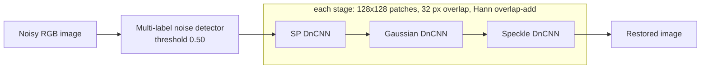

# Noise-Adaptive Image Denoising with Overlap-Weighted Patch Reconstruction

[](https://github.com/Navadeep-Bandi/image-denoising-cnn/actions/workflows/ci.yml)

A PyTorch project that restores images corrupted by **Gaussian, salt-and-pepper or speckle noise**. A multi-label CNN detector estimates which noise types are present, noise-specific **DnCNN** denoisers remove them, and full-resolution images are rebuilt from 128x128 patches with **Hann-weighted overlap-add**. The repository contains the code, trained checkpoints, archived experiment results, a Streamlit app, the IEEE research-paper source and presentation slides.



## Key findings

Evaluated on DIV2K validation images 0801-0820 at full resolution, 3 noise families x 3 severities (180 cases), paired statistics:

| Question | Result |
|---|---|
| Hann 25% overlap vs no overlap | **+0.26 dB PSNR** (95% CI 0.23-0.29), better in 180/180 cases |
| Hann vs uniform blending | +0.074 dB (better in 99% of cases) |
| More overlap than 25%? | +0.0003 dB for 2.1x the time: **not worth it** |
| Detector | 180/180 exact on single-noise cases; routing costs +0.34 s (+43%) with no quality loss |
| Full pipeline | mean PSNR 21.32 -> 37.03 dB, SSIM 0.482 -> 0.899 |
| Weak spots | Gaussian sigma >= 25/255; severity-specific Basic CNN worsens 43/180 cases at low noise |

Full tables and failure cases: [`docs/RESULTS.md`](docs/RESULTS.md). These results use synthetic single-family noise on 20 images; they do **not** show real-world or mixed-noise robustness, and the project makes no state-of-the-art claim.

## Quick start

```bash
git clone https://github.com/Navadeep-Bandi/image-denoising-cnn.git
cd image-denoising-cnn
python -m venv .venv
# Windows: .venv\Scripts\activate      macOS/Linux: source .venv/bin/activate
pip install -r requirements.txt
python -m streamlit run app.py
```

Trained checkpoints are included in `models/`, so the app runs without any download.

## Research paper

**A Noise-Adaptive Patch-Based Image Restoration Pipeline: Overlap-Weighted Reconstruction, Boundary Behaviour and Cost**

The IEEE-format paper source, generated tables and analysis scripts are maintained in [`paper/`](paper/). The compiled paper is available as a [downloadable PDF](docs/Research_paper.pdf). Open [`paper/main.tex`](paper/main.tex) to inspect the manuscript or upload the `paper/` folder to Overleaf to compile it. Search for `\todo{` in the LaTeX source for author items that still require verification.

## Supporting materials

- [Experimental results and failure cases](docs/RESULTS.md)
- [Training protocol and documented limitations](docs/TRAINING_PROTOCOL.md)
- [Research presentation](slides/research_presentation.pptx)
- [Source code and experiment scripts](src/)

## Reproduce the experiments

The DIV2K dataset is **not** included; download the validation HR images from the [official DIV2K page](https://data.vision.ee.ethz.ch/cvl/DIV2K/) into `dataset/DIV2K_valid_HR/`, then:

```bash
python run_all_experiments.py --limit 20 --device cuda      # experiments 1-5 (writes to results/experiments)
cd paper/analysis && python make_tables.py                  # regenerate the paper's tables + paired statistics
```

Individual experiments live in `src/evaluate_*.py`: blending (Exp. 1), boundaries (Exp. 2), overlap sweep (Exp. 3), efficiency (Exp. 4), noise detection and restoration (Exp. 5). The 100-image Basic CNN vs DnCNN comparison is `src/evaluate_all_models.py`.

## Repository layout

```text
app.py                      Streamlit app (detect, restore, compare)
run_all_experiments.py      runs experiments 1-5 and writes a consolidated summary
src/                        models, noise generation, patch inference, evaluation scripts
models/                     trained checkpoints (detector, 3 DnCNN, 9 Basic CNN)
results/                    archived per-case CSVs and figures
paper/                      IEEE paper source, generated tables, analysis scripts
slides/                     presentation
docs/                       RESULTS.md, TRAINING_PROTOCOL.md, archive/ (earlier drafts)
```

## Reproducibility and limitations

- Timing is a **single run per case**, hardware and library versions were not recorded, and each experiment was timed in its own pass; compare times within one table only.
- The **training scripts are not in this repository** (see [`docs/TRAINING_PROTOCOL.md`](docs/TRAINING_PROTOCOL.md) for what the shared code does specify). Denoiser optimizer settings are documented in that file; the detector's training settings and the origin of the clean training images are still undocumented.
- Dependencies are not version-pinned; checkpoint SHA-256 hashes are in `results/experiments/preflight_checkpoint_sha256.json`.
- The Basic CNN (2 epochs) and DnCNN (40 epochs) had very different training budgets, so their gap is not an architecture-only comparison.
- Detector scores are not calibrated probabilities.
- No comparison against SwinIR, Restormer, NAFNet, PromptIR or MambaIR was run.

## Team

Bandi Navadeep, Rajan Nayak, Rohit - Department of Artificial Intelligence and Data Science, IIIT Raichur.

## License

No license has been chosen yet, so all rights remain with the authors. Add a `LICENSE` file (for example MIT) if you want others to reuse the code.
